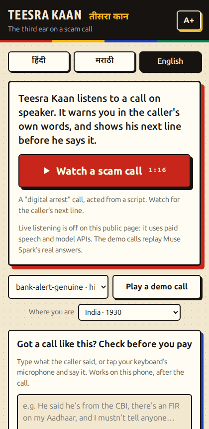

# Teesra Kaan — the third ear on a scam call

**Put a suspicious call on speaker and open the page. Teesra Kaan listens in Hindi, Marathi or English, and the moment the caller starts a known scam it warns you in your language, quoting the caller's own words. Then it shows you the caller's next line before they say it, and ticks it off in their own words when they do. When the call ends, it hands you a ready report for 1930 and cybercrime.gov.in, or for ReportFraud.ftc.gov in the US. Alone with one phone? Type what the caller said, and it names the scam and shows what they'll ask for next, before you pay.**



*Right: the page playing a written demo call at 4× speed, judged by Muse Spark 1.3 (its real replies, saved in [`examples/spark-replies/`](examples/spark-replies) so the page replays them without a key). The card names the caller's next line before he says it and ticks it off in his words, then the red warning quotes him. A call re-enacted by people on a real phone line, heard by Muse Voice Transcribe at real-time speed, is the live run in the video ("Does it work?" has its timeline).*

- **Live:** https://teesrakaan.aryangorde.com (the demo calls and the "check before you pay" box; live listening runs on the laptop, see [deploy/README.md](deploy/README.md)). The public page has no model key: the demo calls and the box's "Try an example" replay Muse Spark's real answers, and anything else you type there is checked by the keyword stand-in, which the page says on screen.
- **Video (3 min):** *(link on Nov 4)*
- **Built during** the Meta Global AI Developer Hackathon, Oct 26 – Nov 4, 2026. Every commit in this repo is from those dates. One module is adapted from code written earlier in the same event: the spending ledger in `src/teesrakaan/budget.py` comes from this hackathon's first project, Double Take (Oct 27, 2026). The project changed after the application; the submission says so.

## Why
In 2024 Indians lost ₹1,935.51 crore to "digital arrest" calls alone, and ₹22,845.73 crore to cyber fraud overall (Ministry of Home Affairs replies in Parliament; sources in [docs/figures.md](docs/figures.md)). The script is always the same: a "police" or "bank" caller, a threat, "don't tell anyone", then an ask for money or an OTP. Caller ID flags numbers; nothing listens to what is being said, in the language it's said in.

The script isn't only Indian. Americans reported losing $3.5 billion to impostor scams in 2025, about $920 million of it to government impersonators (FTC). So Teesra Kaan is built for India's scam calls and tested on America's too: the frozen test includes 150 real US scam robocalls. Set to the US ("Where you are"; it starts on India), a red warning and the report send you to your bank and ReportFraud.ftc.gov instead of 1930, with fact lines from the FTC's advice.

## The next line
A warning often loses to fear. In September 2026 a retired doctor in Rajkot sent ₹58.5 lakh to "digital arrest" callers even after her bank warned her ([DeshGujarat](https://deshgujarat.com/2026/10/02/despite-bank-warning-doctor-gripped-by-fear-transfers-%e2%82%b958-50-lakh-in-digital-arrest-scam/)). What a frightened person can't argue with is proof that the caller is reading from a script, and a field experiment found that forewarning people about a specific scam made them less likely to fall for it ([Scheibe et al., 2014](https://longevity.stanford.edu/forewarning-reduces-fraud-susceptibility-in-vulnerable-consumers)).

So Teesra Kaan says the caller's next line before they say it. The ten scam patterns in [docs/scam-tactics.md](docs/scam-tactics.md) are written in [`playbook.py`](src/teesrakaan/playbook.py) as ordered steps, taken from the police, RBI and DoT advisories. Once two steps of a script have been heard, the page shows the next one:

> **Next line in this scam's script:** "Don't tell anyone. Don't hang up."

When the caller says it, the line is ticked: *"The caller just said it: “kisi ko mat batana…”. This call is following a scam script."*

- **Fixed scripts make the prediction, not a model.** It predicts only when every script that fits the call so far names the same next step. After "police" and "FIR" alone, the call could be a digital arrest or a KYC call, so it waits.
- **A line counts only if the caller says it after it was shown.** A line said earlier but recognised late doesn't count.
- **It's measured, not just demonstrated.** The frozen test reports how often the shown lines came true, how many seconds ahead they were, on how many scam calls one was shown, and how many were shown on genuine calls (metric 7 in [docs/evaluation-rule.md](docs/evaluation-rule.md)). A naive guess made at the same moments is compared on the dev set only, because it's scored on the calls it learns from. On the synthetic test calls, 5 of the 8 lines shown came true, a median 5 s before the caller said them. On the FTC robocalls, none of the 43 shown did: those calls end at "press 1", before the ask.

## Three ways it helps
- **During the call, on a second device.** A phone on a call keeps its own microphone: Android gives it to the call, and an ordinary app or browser gets silence ([Android docs](https://developer.android.com/media/platform/sharing-audio-input)). So the page listens from another phone, a tablet or a laptop next to the call on speaker, such as an old phone kept beside a parent's. If it hears only silence, it says so.
- **After the call, on the same phone: check before you pay.** Type what the caller said, or say it with the keyboard's microphone. The page runs the same questions, quote check and rules, names the scam, and shows the rest of its script: *"What they'll do next in this scam: “Don't tell anyone. Don't hang up.” “Transfer the money for verification.”"*
- **Tell family in one tap.** "Don't tell anyone" is the scam's weapon. Every warning has a button that opens WhatsApp (a text message in the US) with a message to family that quotes the caller.

## How it decides
| Step | Meta model | What it does |
|---|---|---|
| 1. Hear | **Muse Voice Transcribe** (realtime, speaker separation, Hindi/Marathi/English bias, scam-term keyword biasing) | Writes the call down as it happens and keeps the two voices apart |
| 2. Ask | **Muse Spark 1.3** (JSON-schema output) | After each thing the caller says, answers 13 fixed yes/no questions about the caller ("claims to be police?", "asks for an OTP?", "says don't tell family?"), quoting the caller's exact words for every yes |
| 3. Check | — | Every quote is matched against what the caller actually said; a quote that isn't there is thrown away, so a made-up reason can't raise an alarm |
| 4. Decide | **Muse Spark 1.3**, as a check | Fixed rules: a warning needs Spark's overall view of the call (asked in a parallel call) to say "scam" *and* at least one warning sign quoted in the caller's own words. If one is an ask for money, an OTP or PIN, an app or a link, it's red. Spark's view alone never warns, and neither do the signs alone, so a real bank's fraud alert stays quiet |
| 5. Predict | — | The signs so far are matched against the ten scam scripts; when they agree on the next step, the page shows the caller's next line, and ticks it when it's said |
| 6. Report | — | At hang-up: the caller's claims with quotes and times; the rupee amounts, Indian phone and account numbers, UPI IDs, emails, links and apps he mentioned; and what to do next |

The questions, rules and the scam patterns they come from (with official sources) are in [docs/scam-tactics.md](docs/scam-tactics.md).

## Does it work?
The test was fixed before any result existed ([docs/evaluation-rule.md](docs/evaluation-rule.md)). It was run once, on Nov 1, 2026 (12:02–12:29 IST), on the commit tagged `eval-freeze`. These are its numbers exactly as `teesrakaan table` printed them, with 95% intervals. The full tables are in the [dev-log](docs/dev-log.md), Nov 1. Every transcript, Muse Spark reply and call outcome the run saved is in [evidence/](evidence/): `.venv/bin/python eval/replay_frozen.py` replays the run offline, with no key, and checks every table against it.

Compared on the same calls: **A** keyword lists + the same rules, **B** Muse Spark asked "is this a scam?", **C** Teesra Kaan.

| Test set | A: keywords | B: Spark alone | C: Teesra Kaan |
|---|---|---|---|
| **FTC**, 132 real impersonation robocalls: warned | 121/132 (86–95%) | 132/132 (97–100%) | 131/132 (96–100%) |
| FTC: red | 11/132 (5–14%) | 132/132 (97–100%) | **0/132** (0–3%) |
| FTC, 16 sales robocalls: warned, red | 7, 0 | 16, 16 | 13, 0 |
| **IN-synth scam**, 18 calls, synthetic voices: warned | 17/18 (74–99%) | 18/18 (82–100%) | 18/18 (82–100%) |
| IN-synth scam: red | 13/18 (49–88%) | 18/18 (82–100%) | 17/18 (74–99%) |
| Time to warning, median (90th pct), from the first scam move | 21 s (28 s) | 21 s (27 s) | 22 s (29 s) |
| Warned before the ask | 8/16 | 7/16 | 7/16 |
| **IN-synth genuine**, 15 calls: red false alarms, amber false alarms | 1/15, 1/15 | 0/15, 0/15 | 0/15, 0/15 |
| **No keywords left**, 9 synthetic scam calls rewritten without one keyword: warned | **0/9** (0–30%) | 9/9 (70–100%) | 9/9 (70–100%) |
| The next line, IN-synth scam: came true | 4/10 (17–69%) | – | 5/8 (31–86%), 5 s ahead |

What this shows, and what it doesn't:
- **C never went red on the FTC robocalls.** They say "press 1" and hang up before asking for money, an OTP or an app, and red waits for that ask (or for authority, threat and isolation together). C warned amber on 131 of 132. B went red on every FTC call, all 16 sales robocalls included.
- **Keywords alone break when the words change.** With every keyword removed, A warned on none of the 9 rewritten calls, and C warned on all 9. Not one keyword came back in their transcripts.
- **On warning at all, Spark alone did as well as C** on these sets. What C adds is a quote in the caller's own words for every warning, red only at the ask, and the next line.
- **The Indian test calls are synthetic voices, not people.** The re-enactments by people, the speakerphone re-recordings and the ablations that need them (without the language hint or keyword biasing) aren't recorded yet, so they aren't here. Without speaker separation, C scored the same on FTC: 131/132 warned, 0/132 red.
- **One call so far has real voices, outside the test.** On Nov 1, after the test run, we re-enacted the English digital-arrest demo script on an ordinary phone call (one of us the caller, a family member the person called), recorded by the phone. Muse Voice Transcribe heard the recording at real-time speed, nearly word for word and with the two voices kept apart, and Muse Spark and the frozen rules judged it. **Amber at 0:17**, 17 s after the first false claim, with the next line "Come on a video call.", which he said at 0:38; **red at 0:40** with "Transfer the money for verification.", **5 s before he asked for the money** (0:45). It's the call that opens the video. One call, read by the people who wrote the script, is an example, not a measurement.

| Set | What it is |
|---|---|
| **FTC** | 200 real US scam robocalls from the FTC's Project Point of No Entry (public domain), 50 dev / 150 test |
| **IN-synth** | **Synthetic voices, not people:** the Hindi, Marathi and English test scripts (18 scam, 15 genuine) and 9 paraphrase scripts, spoken by Kokoro through a phone band, fixed before the freeze ([eval/synthetic.py](eval/synthetic.py)); always reported apart |
| **IN-scam / IN-genuine** | 40 scam and 30 genuine calls in Hindi, Marathi, English and Hinglish, written from police, RBI and NPCI advisories (28 dev / 42 test), to be re-enacted by people on speakerphone. Not recorded yet |
| **IN-real** | Real scam calls donated by Indian families with written consent (private; numbers only). None so far: none of the 10 people we asked had a recording |

Every number in the video comes from `teesrakaan table` on that run. Development steps and their dev-set numbers are logged in [docs/dev-log.md](docs/dev-log.md).

## What people said
On Oct 31 we phoned 10 people (5 elderly, 3 middle-aged, 2 Gen Z), told them it was for this hackathon, and showed them the page. By Nov 1 all 10 had used it themselves.
- **Every one of them gets at least one scam call a week**; some get three or four. The two Gen Z and some of the middle-aged don't pick up such calls.
- **One of the five elders lost ₹20,000.** The caller used the name of someone he knew and said he was sending ₹25,000. A fake SMS showed ₹45,000 credited, and the caller asked for the "extra" ₹20,000 back. It was sent, and never reported: he thought he would look like a fool.
- **All 10 used it: the demo calls, "check before you pay" and the tell-family button.** The five elders used it in Hindi (2), Marathi (2) and English (1). Almost everyone understood the warnings on their own; the elders needed a little explanation first. Most said they would keep it open when an unknown number calls.
- They liked the interface, and said having it in their own language was a sweet addition.

Before the freeze, we taught Teesra Kaan that call as its tenth script ([scam-tactics.md](docs/scam-tactics.md) v1.4: the fake "money sent" SMS, then "too much went by mistake", then "send the extra back"). Written down as he described it, with made-up names ([eval/probe_wrong_credit.py](eval/probe_wrong_credit.py)), in Hinglish and in English it turns **amber at "too much went by mistake", shows the caller's next line, "Please send the extra back to this number", before he says it, and goes red when he does.** It's on the page as a demo call, "Sent too much by mistake". The keyword lists miss the English one. That is one written call, not a test; the test is above.

## What already exists
AI that spots scam calls is not new. This is what we found, and how Teesra Kaan differs.

| What | What it does |
|---|---|
| [Google Scam Detection](https://blog.google/security/new-ai-powered-scam-detection-features/) | On-device warnings during calls in Google's own Phone app, on Pixel phones. In India since Nov 2025 in Hindi and English ([TechCrunch](https://techcrunch.com/2025/11/20/google-steps-up-ai-scam-protection-in-india-but-gaps-remain)); off by default ([Techlicious](https://www.techlicious.com/blog/new-google-scam-call-and-text-warning/)); on Galaxy S26 phones in 2026 ([TechRepublic](https://www.techrepublic.com/article/news-google-gemini-scam-detection-android-samsung-expansion/)) |
| [Hiya AI Phone](https://www.helpnetsecurity.com/2025/01/28/hiya-ai-phone/) | Screens unknown callers, and analyses call audio in real time for scam language and AI voices |
| [Savi](https://letsdatascience.com/news/savi-launches-app-to-block-ai-scams-e87998af) (Jul 2026) | Screens calls, texts and voicemail for AI scams, with live-call monitoring |
| [Truecaller Family Protection](https://techcrunch.com/2026/03/12/truecallers-now-lets-you-hang-up-on-scammers-on-behalf-of-your-family/) (India, Mar 2026) | Lets a family member hang up a scam call for someone else |
| Hackathon projects: [ShaScam](https://devpost.com/software/shascam), [Call Cop](https://devfolio.co/projects/call-cop-f7a1), [a FOSS Hack 25 entry](https://fossunited.org/hack/fosshack25/p/b7vum5on5h), [Guardian Angel](https://nyc.aitinkerers.org/hackathons/h_Xu4dbx3kfMs/entries/ht_59nCFqZrOQQ) | Live scam-call detection |
| [ScriptMind](https://arxiv.org/abs/2601.13581) (EACL 2026 Industry Track) | Research: an 11B model fine-tuned on 571 Korean phone-scam cases infers the scam's script and predicts the scammer's next utterance |
| [PreScam](https://arxiv.org/abs/2605.12243) (May 2026) | Research: a benchmark built from real scam reports; it found that "next-action prediction remains only moderately successful even for strong LLMs" |

**How Teesra Kaan differs:**
- **The next line, live, in Hindi, Marathi and English.** The two papers predict the scammer's next move in research settings (Korean cases with simulations; written scam reports), and neither abstract describes a live tool or an Indian language. Ours comes from fixed scripts out of the advisories, not from a model, which is where PreScam found models weak.
- **It shows its proof.** Every warning quotes the caller's own words, and a quote the caller never said is thrown away.
- **The model can't warn on its say-so.** Fixed rules decide, every warning needs a sign quoted in the caller's own words, and Muse Spark's overall view only holds a warning back or confirms it. On the dev set this kept all 12 genuine calls silent, and on the test none of the 15 synthetic genuine calls was warned on.
- **It's measured** on a test fixed before any result, on real FTC robocalls and Indian calls read by synthetic voices, against keyword lists and against Muse Spark asked plainly "is this a scam?".
- **It works with any call app,** because it listens through the speaker. Digital-arrest callers move people to WhatsApp and Skype video calls, outside a phone maker's own dialer.

## Try it
```bash
uv venv --python 3.12 .venv && uv pip install --python .venv/bin/python -e '.[web]' pytest
.venv/bin/teesrakaan serve            # open http://127.0.0.1:8000 and play a demo call
.venv/bin/python -m pytest            # 100+ tests, no network, no key
```
Live listening and the Meta-model runs need `MODEL_API_KEY` in `.env` and `TEESRAKAAN_ALLOW_PAID=1`; every paid call goes through a ledger that stops at $100 of the $150 credits, and is refused unless Meta's own meter, read from the Billing page, agrees ([docs/spending.md](docs/spending.md)). Paid calls also end at Nov 5, 2026, 00:00 IST, before our hackathon credits' window closes; to run it with your own key after that, change `PAID_UNTIL` in `src/teesrakaan/budget.py`. The full sequence is in [docs/runbook.md](docs/runbook.md).

The demo calls in `examples/calls/` are written scripts, not real calls; every name, number and ID in them is made up. Without a key, the page plays them with Muse Spark's saved replies from `examples/spark-replies/` (made with `teesrakaan demo-replies`), so the hosted demo shows the real model at no cost.

## Limits (honest)
- The Indian test calls so far are synthetic voices reading scripts written from advisories; the FTC calls are real but American and in English. One call has been re-enacted by people on a real phone line, outside the test ("Does it work?"). No real Indian call has been donated: none of the 10 people we asked had a recording. Each set is reported separately, with 95% intervals, and the sets are small: 18 synthetic scam calls give a range of 82–100% for 18 of 18.
- Speaker separation labels voices "A" and "B"; the caller is taken to be whoever has said the most so far, which can be wrong in the first seconds. If it changes its mind, the signs already found stay counted, even ones the other voice said.
- **Elders need it explained once.** The five elders who used it understood the warnings after a little explanation, not before, so someone in the family should set it up with them the first time.
- Live listening needs a second device near the call on speaker, because a phone on a call keeps its own microphone. It doesn't intercept calls. On one phone it can only check a call afterwards, from what you type.
- A warning is advice, not a verdict. The genuine-call set measures how often it warns when it shouldn't.
- **A relative asking for money is the hardest case.** On the dev set, a daughter asking her mother for mess fees, who added "I'll video call on Sunday", went red under the first rules (an ask plus one more sign). With Muse Spark's overall view as a check, it stays silent, but that's one call. The "Hi Maa, this is my new number" scam sounds the same, and only the test set says how often each is judged right ([dev-log](docs/dev-log.md), Oct 30).
- **It hears a turn when the turn ends.** The transcriber says who spoke only at the end of each turn, and nothing is judged before we know it was the caller. A long monologue can delay a warning by up to one turn.
- The next line knows only the ten scripts. A new script, or one played in an unusual order, gets no prediction or a wrong one; the test counts both. The tenth was added on Oct 31, before the freeze, after an elder we phoned lost ₹20,000 to it ("What people said"). On the synthetic test calls, 5 of the 8 lines shown came true, a median 5 s ahead; on calls by people, it hasn't been measured: the one re-enacted call above is a single example (both lines it showed came true, 21 s and 5 s ahead).

## Layout
| File | What it does |
|---|---|
| `src/teesrakaan/signals.py` | The 13 signal questions and the alarm rules |
| `src/teesrakaan/playbook.py` | The ten scam scripts as ordered steps, the next line they predict, and the rest of the script for a call checked afterwards |
| `src/teesrakaan/listener.py` | Hears the call, asks the judge, checks quotes, keeps the alarm. The same code runs live and in the evaluation |
| `src/teesrakaan/judge.py`, `keywords.py` | The Muse Spark prompt and parser; the keyword baseline |
| `src/teesrakaan/spark.py`, `asr.py`, `budget.py` | Muse Spark and Muse Voice Transcribe clients, behind a $100 hard stop checked against Meta's meter |
| `src/teesrakaan/live.py`, `web/` | Live listening and the page |
| `src/teesrakaan/web/studio.py`, `voice.py` | The recording studio (this laptop only): records each re-enactment the way the page hears a call, and saves its labels, made by listening before any output is seen. It also records the spoken warnings, which the page plays in place of the browser's voice |
| `src/teesrakaan/simulate.py`, `metrics.py`, `labels.py` | Replays calls with real delays; Wilson 95% intervals; the labelling sheet and fixed splits |
| `src/teesrakaan/report.py`, `messages.py` | The 1930 report and the warnings, in English, Hindi and Marathi |
| `eval/` | Re-enactment scripts, their split, FTC dev labels |
| `evidence/` | The frozen test run's transcripts, Muse Spark replies and per-call results; `eval/replay_frozen.py` replays it offline |
| `deploy/` | The server setup for the live page |

## Licence
MIT. The FTC recordings are public domain (NCSU Robocall Audio Dataset); they're fetched by `teesrakaan ftc-fetch`, not stored here.

The synthetic test set's voices, and the voices of the two English demo calls on the page (`examples/calls/*-en.m4a`, labelled as synthetic while they play), are **Kokoro v1.0** (hexgrad, Apache 2.0). The kill check's real voices are from **FLEURS** (Google, CC BY 4.0), used on dev only and not stored here. Not ours, used in the demo video under their licences: narration voiced with **Chatterbox TTS** (Resemble AI, MIT), its built-in voice, not a real person's; music: "Immersed" by **Kevin MacLeod** (incompetech.com), licensed under CC BY 4.0; sound effects: "Simple Whoosh", "Notification Sound Effect" and "Error Sound" by **DRAGON-STUDIO** (Pixabay Content License); the demo calls' voices: Kokoro, as above; fonts **Noto Sans, Noto Sans Devanagari, Noto Serif Devanagari** (SIL OFL 1.1).
